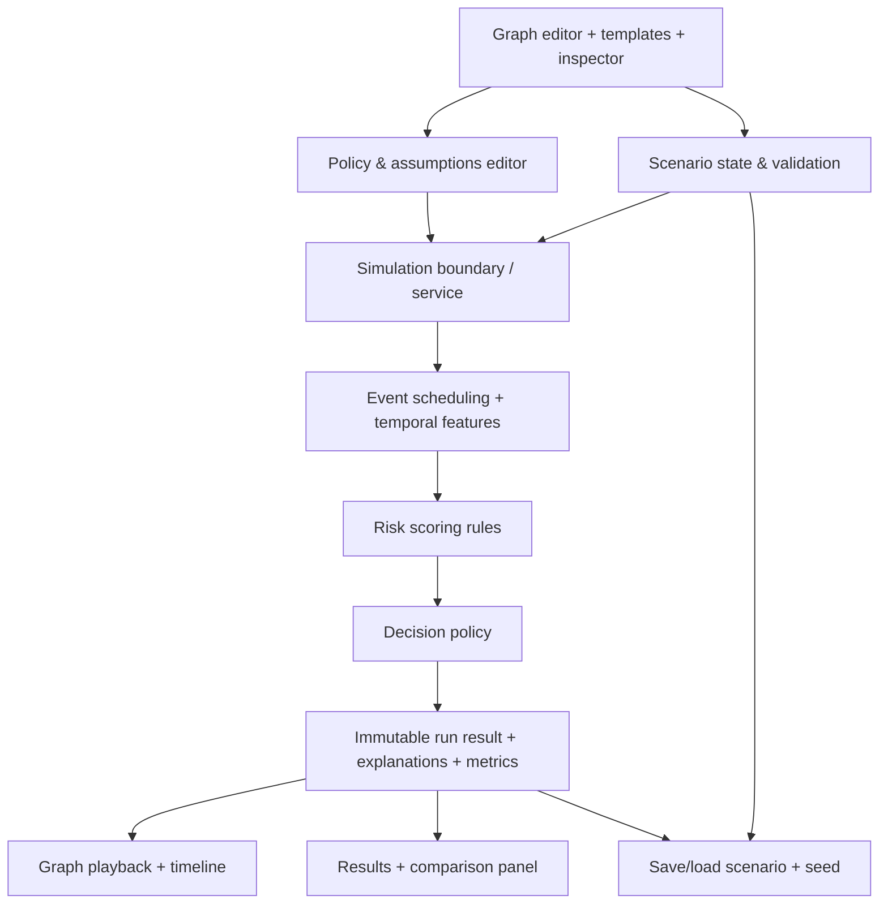

# RiskFlow Studio — Product & Architecture Specification

**Version:** 1.1 — reviewed implementation brief for Codex  
**Status:** Approved direction; scope and execution plan, not an assertion that the product has been built  
**Working name:** RiskFlow Studio (renameable)  
**Category:** Interactive transaction-risk simulation and investigation sandbox  
**Primary goal:** A memorable, visually exceptional portfolio project for technical roles in banking, transaction risk, fraud analytics, and financial software.

> **Directive to the implementing agent:** Treat this document as the project's product contract. Ship a coherent, attractive, working vertical slice before expanding scope. Prioritize visual quality and intuitive interaction, but never fabricate analytical accuracy, pretend a placeholder is a validated model, or leave decorative controls that do nothing. Resolve minor implementation details autonomously; flag substantial scope or architecture changes.

---

## Current roadmap precedence

As of 2026-10-25, [plan.md](plan.md) is the single active roadmap. This original MVP specification is historical context where its scope, status or priorities conflict with that roadmap. V13 is already integrated; the current direction is a portfolio showcase using frozen V13 for the interactive demo and supported experimental uploads, with IEEE-CIS retained as separate offline evidence. Further general-purpose model research is deferred. Preserve established import, saved-result, simulator and graph behavior. The current request updates planning documents only; the new showcase milestones are not yet implemented.

## 1. One-paragraph product definition

RiskFlow Studio is a **visual sandbox for constructing and replaying simulated payment scenarios**. A user places financial entities on a graph canvas, connects them through supported relationships and transactions, adjusts scenario parameters, and presses **Simulate**. The graph comes alive: events travel through the network in time order, suspicious activity is highlighted, and a results panel explains how a transparent risk policy evaluated each event. Users edit the graph or policy and run it again to compare decisions and business consequences. It should feel engaging and tactile, like a high-quality systems sandbox, while looking credible as enterprise financial software—not as an arcade game.

**Portfolio promise:** “I built an interactive graph-based transaction-risk simulator that makes fraud policy behavior understandable through visual scenarios, reproducible analysis, and business-impact comparisons.”

**Not the promise:** “This can predict fraud on any transaction with real-world accuracy.”

## 2. Audience, positioning, and decision priorities

**Primary audiences**
1. A business/risk hiring manager seeing a 60–90-second demo: must immediately understand the scenario and outcome.
2. An engineering/data hiring manager inspecting architecture and source code: must find coherent separation of concerns and honest methodology.
3. A curious first-time user: must be able to load a template, modify it, and get a meaningful result without a tutorial.

**Priority order for trade-offs**
1. **Exceptional, legible visual experience**: graph composition, high-quality interaction, playback, hierarchy, motion, and clear explanation.
2. **A complete and believable end-to-end interaction**: build → simulate → inspect → change → rerun.
3. **Credible, reproducible analytical behavior**: correct event order, deterministic rules, transparent assumptions, defensible numbers.
4. Feature breadth, sophistication of the prediction algorithm, integrations, and scale.

Spend approximately **55–65% of active development effort on experience/design/front-end refinement**, with the remainder on simulation, verification, packaging, and deployment. This is a prioritization guide, not an excuse to leave core features broken. Every visible result must actually follow from the scenario and policy. Optimize for **perceived quality backed by a real minimum of usefulness**, not appearance unsupported by substance.

## 3. The signature interaction / demo story

A complete demonstration should work as follows:

1. **Open:** A striking but uncluttered dark-mode workspace presents a small, readable transaction network and a short invitation: “Build a scenario. Run the risk engine. See why it flags activity.”
2. **Choose:** Load a curated **Account Takeover** or **Stolen Card Burst** template—or select **Blank Scenario**.
3. **Construct:** Drag nodes, add a payment edge, click a transaction to change its amount/time, and add a new device or location connection. The graph should be satisfying to manipulate.
4. **Simulate:** Press one obvious primary button. Events animate along payment connections according to their timestamps, nodes respond subtly, and the running timeline marks risk assessments and decisions.
5. **Understand:** Selecting an alert reveals a clear, human-readable breakdown of triggered rules and which part of the scenario produced the signal. A compact summary displays policy decisions and, when labels exist, estimated business consequences.
6. **Experiment:** Change a transaction, relationship, or policy threshold; rerun. See the **delta versus the previous run**, such as fewer blocks but more fraud exposure under that synthetic scenario.

The graph is the hero. Charts and KPI cards support the graph; they must not overwhelm it. The reference mood is a **central, glowing financial network on a premium dark operations canvas**—not a generic dashboard with a token graph in the corner. Reserve the most visual attention for the event paths and their outcomes.

## 4. Visual and interaction specification (first-class requirement)

### 4.1 Visual identity

- **Mood:** Premium, modern financial operations console. Dark midnight/slate backgrounds with restrained cyan/ice-blue network highlights, amber for review, coral/red for blocked/high-risk, and muted green for approved. Use color sparingly and consistently.
- **Typography:** Clean, readable enterprise typography. Clear hierarchy between scenario title, numeric outcomes, edge labels, explanations, and secondary metadata.
- **Spatial composition:** Generous spacing, strong alignment, thin separators, tasteful depth/glow, and a visually balanced canvas. Avoid dense “crypto trading terminal” clutter and flashy arcade UI.
- **Motion language:** Edges pulse when transactions execute; a small amount of directional movement communicates timing. Alerts appear with subtle transitions. Use short, purposeful animation rather than constant particle effects.
- **Accessibility:** Distinguish decisions with icons/text in addition to color; maintain contrast; honor reduced-motion preferences; keyboard-focus visible on actionable elements.

### 4.2 Desktop-first workspace layout

**Top bar:** Product title, current scenario, unsaved-changes indicator, **Simulate**, pause/replay/reset, and export/share affordances when implemented.

**Left rail:** Curated scenario templates plus the small palette of supported node types. Keep creation controls obvious but visually quiet.

**Center (largest region):** Pan/zoom graph canvas with connections, event animations, contextual badges, and clear selected/hover states. Node placement is editable; spatial placement is *visual only* and does not change risk calculations.

**Right inspector:** On node/edge selection, edit its supported properties; in result mode, show **Why flagged?** with triggered signals and supporting event information. Switch context without stacking multiple competing panels.

**Bottom strip:** Replay timeline / event list. During and after playback, show a compact result summary and a **Compare with previous run** affordance. Expand detailed metrics on demand.

**Responsive intent:** Optimize for laptop/desktop at ~1366–1440 px wide. At smaller widths, collapse rails into drawers and preserve a functioning view/inspect experience. A fully featured mobile editor is explicitly not part of the MVP.

### 4.3 Interaction requirements

- Smooth node drag, edge selection, zoom/pan, fit-to-view, contextual add/remove, and undo/redo if stable within scope (otherwise defer undo/redo explicitly). Dragging or adding nodes should reveal valid connection targets and a clear connection preview.
- Clear feedback for invalid graph connections; never silently permit an edge that the engine cannot interpret.
- Click an event/edge to inspect amount, time, account, merchant, contextual signals, and decision.
- Simulate → pause/replay. Timeline visibly advances. Scrubbing to a past event is a **stretch** if it threatens the time budget; step-by-step replay is an acceptable MVP substitute.
- Template reset, scenario reset, and “Run again” are obvious. Interactions should feel responsive, with meaningful empty/loading/error states.
- No inert buttons, fake live counters, or misleading real-time claims.

## 5. Deliberately narrow financial domain

**MVP domain: simulated consumer card purchases and account behavior, evaluated for payment-fraud risk.** This constraint makes the results interpretable and the underlying system achievable.

**Node types (four):**

| Node | Purpose | Example relevant properties |
| --- | --- | --- |
| **Account** | Payment source and behavioral baseline | Synthetic ID, age, usual geography, typical spend, usual activity |
| **Merchant** | Payment recipient | Synthetic ID, merchant category, region |
| **Device** | Device used by an account | Synthetic ID, seen-before/novel status, associated account(s) |
| **Location** | Transaction/account-use context | Region/country code, usual/unusual relative to account |

**Edge/event types:**

| Type | Meaning | Simulation impact |
| --- | --- | --- |
| **Payment event: Account → Merchant** | A dated transaction with an amount, merchant, device/location context | Primary event that gets scored and a policy decision |
| **Account ↔ Device association** | Device history/usage relationship | Context for familiar/new-device rules |
| **Account ↔ Location association** | Known or observed geographical context | Context for unusual-location rules |

The editor must distinguish **persistent relationships** from **timestamped payment events** visually and in its internal model. A line on the canvas is not automatically a transaction. **Multiple payments between the same account and merchant are separate events with unique IDs and timestamps**, even if the canvas groups them into one attractive visual connection with an event count; the inspector and timeline must expose each payment individually. Device and location associations should only affect scores through explicitly defined, explainable logic; avoid accidental implied causality based solely on layout. **Known-before versus newly observed associations must be time-aware**: an account/device connection created during the scenario cannot retroactively make that device “known” for earlier payments. A payment event's effective device and location must be unambiguous—selected explicitly or derived from a documented rule.

**MVP template set (three fully verified templates):**
- **Everyday Purchases:** several ordinary payments; largely approved.
- **Stolen Card Burst:** multiple rapid purchases and unusual merchants/amounts; some review/block decisions.
- **Account Takeover:** established account, novel device/location, then unusual spending; visually compelling alerts.

**Optional fourth template:** High-Value Unusual Purchase, if it adds an interesting contrast without expanding the entity system.

**Explicitly excluded from MVP:** bank-to-bank transfers, AML/money-mule graphs, loan underwriting, mortgage pricing, blockchain analysis, real card networks, real banking accounts, real user financial data, and unrestricted “any financial transaction” simulation. These require different entity/event semantics and models. The architecture may support future scenario types, but the interface must not advertise them until implemented.

## 6. Simulation and analytical contract

### 6.1 What actually happens when Simulate is pressed

1. **Validate scenario:** All required properties and allowed connections are present. Show useful inline errors if not.
2. **Build event schedule:** Order dated payment events by timestamp, with stable tie-breaking.
3. **Compute context/features:** Derive per-event behavior from only information available **at that time** (for example, spend vs baseline, recent payment count, known device, usual location). Do not leak future events into earlier scores.
4. **Evaluate risk rules:** Apply a small, documented set of deterministic rules and generate an interpretable **risk score (0–100)** plus triggered-signal list.
5. **Apply decision policy:** Translate the score into **Approve**, **Review**, or **Block** using configurable thresholds.
6. **Produce immutable run result:** Event-level outcomes, a replay timeline, score explanations, assumptions, and aggregate statistics are stored with the scenario snapshot and policy version.
7. **Replay visually:** Animate the **completed run result**; visual playback never recalculates or alters business logic. Users can rerun after edits to produce a new snapshot.

**Critical separation:** The visual graph is the **editor and rendering** of the scenario, not the simulation engine. Dragging nodes to a different screen position cannot change their financial behavior. Event data, not animations, determine results.

### 6.2 Risk assessment, without false promises

- **MVP = rules-based risk scoring**, not trained fraud-probability prediction. A risk score of 80/100 must be labeled **Risk Score**, not “80% chance of fraud.”
- Use a small set of readable signals: unusual amount, payment velocity, new device, unusual location, and optionally merchant/category deviation. Each signal should be inspectable in the interface.
- The score-to-decision policy is adjustable, with a **review threshold below a block threshold** and clear validation of impossible configurations. The interface must show that **changing a policy threshold changes decisions, not underlying event risk scores**.
- “Why flagged?” lists specific triggered rules and values. Never present rule weights as SHAP, causal explanations, or validated model attribution.
- **Optional future ML:** A trained baseline classifier, calibration and honest holdout evaluation can be added later through the risk-engine interface. No ML requirement for the initial credible demo.

### 6.3 Labels and business metrics: avoid invalid math

Synthetic template payments may include a separate **hidden ground-truth label** (fraudulent / legitimate). That label is for evaluating a policy and **must not be used as an input to scoring**. Custom events may be **unlabeled**.

**Always available (whether or not labels exist):** transaction count and amount, approve/review/block counts and rates, flagged/review workload, decision distribution, score distribution, and rule-trigger explanations. Define **flagged = Review + Block** (and keep the component counts visible); a flag is not a proven fraud case.

**Available only for explicitly labeled synthetic events:** fraud caught by a **block**, fraud approved/missed, legitimate payments blocked, false-block rate, and other truth-dependent performance measures. Clearly indicate the labeled subset and denominator; e.g., **legitimate block rate = blocked legitimate / all labeled legitimate payments**. Review is **pending human decision**, not automatically counted as fraud prevented.

**Business-impact estimates use named, editable assumptions**, not claims about a real bank: for example, fraction of approved fraudulent amount ultimately lost, cost per manual review, and an assumed customer-friction cost per wrongly blocked legitimate payment. Make an optional illustrative total-cost calculation from these components, with formulas documented and the assumptions exposed. Do not call an alert “loss prevented” merely because it was flagged. For unlabeled custom scenarios, hide truth-dependent and loss-prevention metrics rather than inventing ground truth or treating scores as calibrated probabilities.

**Ground-truth governance:** Templates have internally consistent labels. A user can edit the facts of a labeled transaction; the interface must explicitly allow preserving or clearing its synthetic label, with a brief explanation that the label describes the constructed scenario's intended outcome, not a prediction. Any newly added transaction defaults to **unlabeled** unless explicitly labeled for a synthetic experiment. The UI must identify when comparative truth-based metrics rely on assumed labels. Never silently reclassify the label to match the engine's prediction.

## 7. Conceptual program architecture

Architect the product as **independent scenario, execution, and presentation layers**. Use established libraries for graph interaction and animation rather than writing a graph renderer from scratch. Keep enough boundaries for a future trained model, but do not build a general-purpose plugin platform now.

### 7.1 Component responsibilities

| Component | Owns | Explicitly does **not** own |
| --- | --- | --- |
| **Scenario model / validation** | Typed entities, relationships, dated events, assumptions, scenario ID/version, validity | Screen coordinates as business logic, fraud scoring |
| **Graph editor** | Manipulation, selection, layout, inspector, visual affordances | Deciding which transactions are fraudulent |
| **Scenario/template library** | Three curated, deterministic scenarios with labeled synthetic outcomes where appropriate | Production datasets or real-world fraud claims |
| **Simulation engine** | Chronological events, historical/rolling feature derivation, reproducible execution | User-interface animation or mutable browser state |
| **Risk evaluation** | Transparent risk rules, numeric scores, triggered reasons | Claiming statistical probability without calibration |
| **Decision policy** | Adjustable review/block thresholds and outcome mapping | Recomputing intrinsic event scores due solely to policy edits |
| **Results/metrics** | Event outcomes, aggregates, labeled-subset evaluation, stated cost assumptions | Making up unknown truth or unobserved actual losses |
| **Playback/presentation** | Animation, timeline, highlight states, comparisons, explanation display | Changing saved scenario/run outcomes |
| **Persistence/export** | Saved local scenario definitions and run snapshots; portable JSON where practical | Accounts, authentication, cloud sync, sensitive payment data |

### 7.2 Data ownership and lifecycle

- A **scenario definition** contains graph entities, relationships, payment events (stable IDs, timestamps, amount, references to source account, merchant, device and location), baseline account context, rule/policy settings, cost assumptions, and a reproducible random seed if generation is used. Its visual node coordinates are separately stored view metadata.
- A **working scenario** is editable. A **simulation run** captures an immutable snapshot of the scenario plus engine/rule version and its computed outcomes.
- The latest run is displayed; a prior run can be retained for **A/B comparison**. The comparison must indicate exactly what changed, at minimum counts and meaningful outcome deltas. Compare only on a clearly identified basis (same event IDs/scenario, or explicitly mark changed event populations).
- Saving/loading must not accidentally mix stale run results with updated scenario edits; show a visible **“changes not simulated”** state until rerun.
- For MVP, **browser-local scenario saving is sufficient**; portable JSON import/export is optional. The scoring service can be stateless; **do not introduce users, accounts, cloud databases, or distributed services** solely for an impressive architecture diagram.
- Replaying the same immutable run must produce the same visible outcomes; executing the same scenario/rule version/seed must produce identical results. Network errors must never silently fall back to fabricated “successful” analytical results.

### 7.3 Practical technology boundaries (non-prescriptive)

- **Frontend:** React + TypeScript; mature node/edge canvas tooling (e.g. React Flow) and restrained motion/chart libraries.
- **Simulation/scoring:** Python service (e.g. FastAPI) so the portfolio demonstrates an engineering backend as well as UI craftsmanship.
- **State and storage:** Explicit frontend editor state; scenario/run data passed through a stable typed boundary. Prefer local persistence; no operational database required for MVP.
- **Deployment:** One public demonstration URL with reliable initialization and a simple run path. Avoid infrastructure complexity unless required for the demo.

Specific packages, routes, tables, build tools, deployment vendors, and source-level algorithms are implementation decisions for Codex, not requirements of this brief.

## 8. Scope and delivery gates

### 8.1 Must ship in the portfolio MVP

- Professional, visually coherent desktop interface with a **dominant interactive graph canvas**.
- Four supported node types; valid typed connections; editing payment properties; selection and inspector.
- Three polished templates **and** a Blank Scenario with a short empty-state path to a first valid transaction.
- Simulate, replay/pause, clearly communicated temporal order, and meaningful alert animations.
- Deterministic score, rule explanations, approve/review/block decisions, editable thresholds.
- Credible outcome metrics; truth-dependent metrics clearly gated to labeled synthetic transactions.
- Before/after comparison against the preceding run, with scenario-change awareness.
- Predictable error handling, no decorative dead ends, a 60–90-second guided demo route, a usable public deployment, and a concise README/methodology note.

### 8.2 Nice only if the core is excellent

- Detailed timeline scrubbing, polished soundless microinteractions, undo/redo, more scenario templates, sharable scenario links, JSON scenario import/export, comprehensive keyboard shortcuts, additional analytical charts.

### 8.3 Explicitly defer

- ML training and calibrated probabilities; graph neural networks; network-wide AML detection; open-ended scenario scripting; multi-user collaboration; real data/API integration; banking-grade audit/compliance claims; mobile graph editing; large-scale stream processing; extensive backend infrastructure; AI-generated narrative explanations presented as ground truth.

## 9. Build sequence and time budget — AI-assisted, visual-first

**Estimate:** approximately **40–65 hours of active developer time** for a polished, honest portfolio MVP with substantial AI-assisted implementation/debugging. This includes integration fixes and visual iteration, not only generating code. A rough prototype could appear in **14–22 hours**, but should not be represented as finished portfolio quality. A markedly more cinematic, highly polished graph environment may take **70–90+ hours**. These are planning ranges, not delivery guarantees.

| Stage | Time | Exit gate: observable result |
| --- | ---: | --- |
| **0 — Visual direction & scenario contract** | 4–6 h | One screen mockup reviewed at laptop width, design tokens, graph semantics, 3 scenario narratives and defined metric labels |
| **1 — Visual-first interactive shell** | 12–18 h | Attractive, responsive graph stage; nodes/typed edges, inspector, template loading, selection and editing work |
| **2 — Minimal deterministic simulation** | 8–12 h | Validation → chronological events → score → decision; replay with consistent result; tests for key rules |
| **3 — Results, explanations, iteration** | 7–11 h | Real triggered-rule explanations, labeled-vs-unlabeled metric behavior, adjustable policy, previous-run comparison |
| **4 — Polish, verify, package & deploy** | 9–18 h | Smooth 90-second demonstration, clean error states, public URL, README, truthful methodology and recorded demo |
| **Total** | **40–65 h** | Interview-ready first release |

**Scheduling guidance:** At 2–3 focused hours/day, budget approximately 3–5 weeks, depending on debugging and visual polish. Keep a contingency beyond the nominal range if graph-editor integration or deployment is unusually stubborn. Do not sacrifice reliable results merely to match the estimate.

**Stop rules to prevent scope creep**
- At the end of **Stage 0**, inspect the visual composition before substantial implementation: the graph must be dominant, legible, and appealing. At the end of **Stage 1**, test a real interaction with a scenario; stop adding UI decoration until edits are reflected correctly in state.
- At the end of **Stage 2**, the system must generate deterministic decisions before adding more animations.
- At the end of **Stage 3**, if the product has a convincing 90-second story, **freeze feature scope**. Use Stage 4 for quality, not extra modules.
- If behind schedule, drop fourth template, timeline scrubbing, JSON import/export, and extra charts **before** removing graph editability, accurate risk explanations, simulation, or a clear result comparison.

## 10. Acceptance criteria and quality checks

**First-minute experience**
- Fresh visitor can select a template and run it within ~30 seconds, without documentation.
- A visitor can visually identify the account, payment direction, suspicious part of the graph, and the policy's outcome.
- The interface looks deliberate at typical laptop resolution; text, nodes, and controls do not overlap or disappear.

**Core functional behavior**
- Create/edit/remove supported graph elements; invalid edges explain why they are invalid.
- A changed transaction amount, timestamp, device/location context, or policy threshold has an explainable effect **when rules logically warrant one**. Do not force all edits to change scores. Changing thresholds alone must not change event risk scores.
- Payment events run in chronological order. Velocity/context features and known-device/location status use information established no later than the event timestamp. Multiple events between the same nodes remain independently inspectable even if drawn on a grouped connection.
- A repeated run with unchanged scenario/seed/policy yields identical outcomes.
- Pausing/replaying does not change results; visual animation matches recorded events.
- Editing after a run visibly marks results as outdated until rerun.
- On labeled examples, false-block, missed-fraud and illustrative cost figures reconcile with the event-level decisions; unlabeled examples do not display fabricated outcomes.

**Visual & product quality**
- At least three truly differentiated scenarios with appealing graph layouts and visibly different result profiles.
- Coherent, readable color/visual language in approve/review/block states; reduced-motion fallback; useful loading, empty, and error states.
- Visually smooth on a representative desktop for **approximately 5–35 nodes and 10–60 payment events**. These are the intended demo bounds, not a large-network product promise.
- No dead controls, fake metrics, generic placeholder charts, broken demo links, or unverified labels such as “AI predicts 97% fraud.”

**Portfolio quality**
- Public live demo works from a clean browser session with no credentials and a prominent **Try a scenario** entry point.
- README explains the problem, supported scope, architecture, rule-based versus ML distinction, assumptions, limitations, and how to run the project locally.
- A 60–90-second demo video/GIF shows: load template → modify graph → simulate → inspect alert → rerun/compare.
- Automated tests cover graph validation, event ordering, rule evaluation, policy mapping, metric formulas, and reproducibility. Include at least one end-to-end smoke test of the main journey if feasible.

## 11. Key risks and corresponding safeguards

| Risk | Mitigation |
| --- | --- |
| The graph looks impressive but has arbitrary/misleading semantics | Define entity/edge contracts first; prohibit unsupported connections; use an inspection panel that describes what each edge means |
| AI generates a stylish UI with disconnected or hard-coded results | Ensure every metric and animation reads from one actual immutable run result; use known scenario tests |
| Fraud probability claims imply an unvalidated ML model | Start with clearly labeled rule-based **risk scores** and honest limitations |
| Synthetic fraud labels accidentally leak into predictions | Keep labels separate from model/rule inputs; verify with tests |
| A custom graph has no ground-truth fraud labels | Show only calculable activity/decision metrics; explicitly mark evaluation metrics unavailable |
| Changing graph position inadvertently changes decisions | Separate visual layout from scenario events/features |
| Time is consumed by infrastructure, authentication, or ambitious AML graphs | Local-first demo, limited domain, four node types, existing graph library, no distributed services |
| Visual polish masks confusing UX | Do a first-minute usability check; prioritize obvious Simulate and “Why flagged?” flows over decorative features |
| Huge live graphs reduce animation quality | Curated sizes, semantic emphasis and event playback; scale is intentionally limited |

## 12. Codex working agreement

1. Before coding, summarize any assumptions needed to implement this specification and propose a **single coherent screen/interaction design**; do not expand the product scope.
2. Implement as **small, verifiable end-to-end vertical slices**. Prefer a working graph + one template + one genuine simulation over five disconnected screens. At the visual-design gate, present a coherent mockup before spending time expanding features.
3. Use AI to accelerate implementation, but **run the product and verify behavior** before claiming a feature is complete. Maintain simple tests for the engine's assumptions.
4. Preserve a clean separation between editor/view state, scenario definitions, simulation/risk logic, and run results. Do not build unnecessary abstractions for hypothetical future banking products.
5. If visual choices and feature count conflict, **favor fewer, polished, functioning interactions**. If visual choices and mathematical truth conflict, mathematical truth wins.
6. Treat visual references as **directional**: create an original design, not a cloned commercial dashboard.
7. Keep an up-to-date checklist of completed acceptance criteria and document any deliberately deferred requirement. Do not present partial implementation as finished.
8. Avoid external data dependencies, real user financial data, credentials, and promises of production fraud-detection accuracy.

## 13. Definition of done

The project is ready for applications when a stranger can open it, construct or modify a small transaction graph, run a visually pleasing simulation, inspect *why* a transaction was flagged, adjust policy or scenario facts, see a valid before/after comparison, and understand the modeled business implications—**without being misled into believing the project is a validated real-world banking risk engine**. The app must look distinctive, work reliably, and be explainable in a technical interview.
