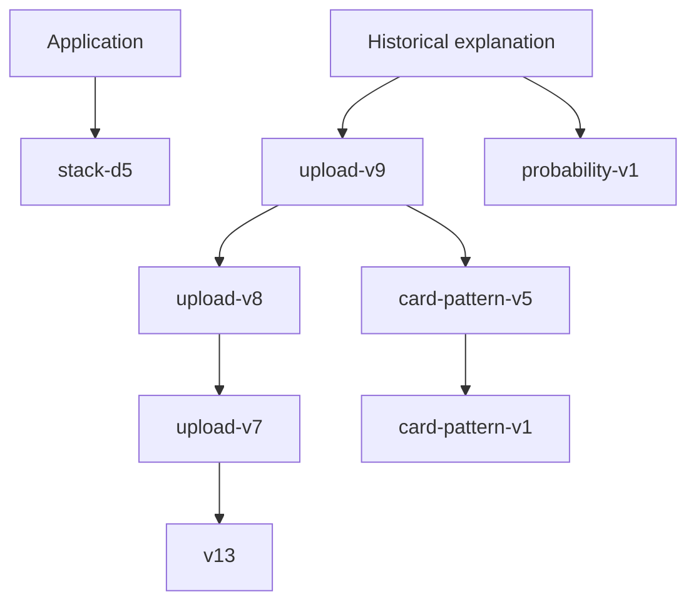

# Packaged inference components

The application serves Stack-d5 from `stack-d5/`: eight frozen experts, the accepted nonlinear head, a safe NumPy reference scale, and a pinned manifest. Its 8.9 MB package has no research or joblib runtime dependency. The older bundles below are retained for historical scores, explanation compatibility and regression tests. Versioned paths and manifest hashes identify immutable trained components and support existing saved results.

| Bundle | Role |
| --- | --- |
| `stack-d5` | Current nonlinear purchase ranking; fixed 1% daily queue |
| `upload-v9` | Historical IBM/authored probability head and channel-specific review cutoffs |
| `upload-v8` | Card/online routing and online margin input to the probability head |
| `upload-v7` | Card teachers, prior-score history and card coverage ensemble |
| `v13` | Base score components used by the coverage runtime and exported score evidence |
| `card-pattern-v1` | Card-pattern margin input and review proposals |
| `card-pattern-v5` | Card-priority margin input and suggestion ordering |
| `probability-v1` | Specialist probability mappings and historical probability contract |

The current scoring path requires only `stack-d5`; historical functionality still requires the older bundles. Model weights, manifests, feature contracts and cutoffs were preserved byte-for-byte during cleanup. Missing or corrupt dependencies produce an unavailable error. Removing or renaming one requires an explicit model migration and prediction-parity validation.

There is no training during requests. Original datasets are optional local research inputs. Research pipelines, training datasets and experiment caches are excluded from the public repository. Bundled weights and frozen fixtures support inference and regression checks, not full training reproduction. See the [repository policy](../../docs/repository-policy.md).
