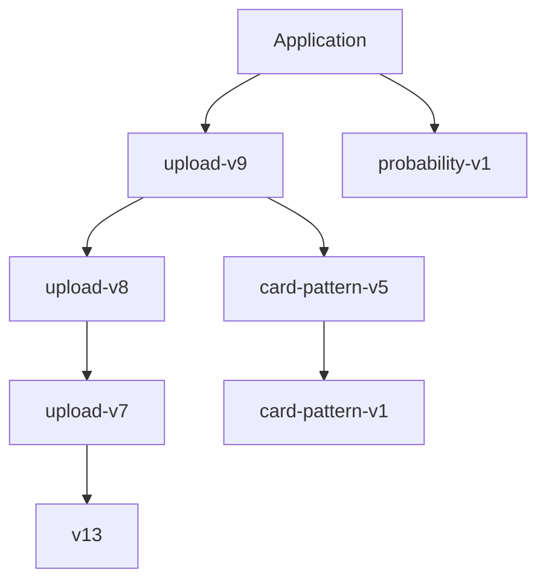

# Packaged inference components

The application serves one selected engine, Upload-v9. These directories contain its active dependency graph, not a collection of selectable model candidates. Versioned paths and manifest hashes identify immutable trained components and support existing saved results.

| Bundle | Role |
| --- | --- |
| `upload-v9` | Current IBM/authored probability head and channel-specific review cutoffs |
| `upload-v8` | Card/online routing and online margin input to the probability head |
| `upload-v7` | Card teachers, prior-score history and card coverage ensemble |
| `v13` | Base score components used by the coverage runtime and exported score evidence |
| `card-pattern-v1` | Card-pattern margin input and review proposals |
| `card-pattern-v5` | Card-priority margin input and suggestion ordering |
| `probability-v1` | Specialist probability mappings and historical probability contract |

All seven packages are required by the current application. Model weights, manifests, feature contracts and cutoffs were preserved byte-for-byte during cleanup. Missing or corrupt dependencies produce an unavailable error. Removing or renaming one requires an explicit model migration and prediction-parity validation.

There is no training during requests. Original datasets are optional local research inputs. Retired training pipelines are described in the [historical reports](../../docs/archive/README.md), but their caches and unused fitted models are no longer distributed.
