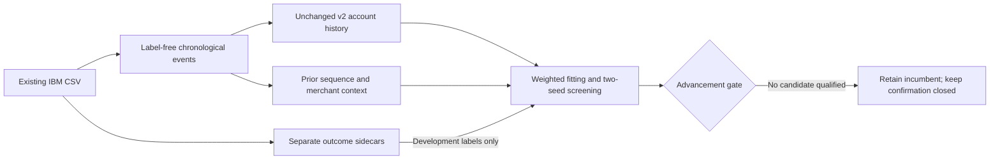

# ML v4: sequence, merchant context and broader training

No candidate passed the predeclared development-screening gate. Retain the v2 soft-history EBM recipe. No final nominee was fitted, no confirmation predictions were generated, and the reserved July–December 2018 outcomes remain unopened for evaluation. This is a completed negative screening experiment, not a statistically confirmed upgrade or proof that these feature families can never help.

## Measured result

All methods ranked the same 103,876 July–December 2018 validation-role purchases, including 174 frauds across 21 users with fraud. Each received 1,039 review slots. The two columns use model seeds 20261024 and 20261025; they are not independent test populations.

| Method | Frauds detected, seed 1 / 2 | Recall, seed 1 / 2 | Average precision, seed 1 / 2 | Screening decision |
| --- | --- | --- | --- | --- |
| Refit v2 incumbent | 106 / 106 | 60.92% / 60.92% | 0.2799 / 0.2750 | Reference |
| Standard CatBoost | 90 / 85 | 51.72% / 48.85% | 0.1654 / 0.1622 | Comparator |
| EBM + account sequences | 106 / 106 | 60.92% / 60.92% | 0.2861 / 0.2775 | No recall gain |
| EBM + merchant context | 107 / 111 | 61.49% / 63.79% | 0.2902 / 0.2401 | Inconsistent gain; AP regressed under seed 2 |
| EBM + broader training | 68 / 70 | 39.08% / 40.23% | 0.1728 / 0.1697 | Recall and AP regressed |

Advancement required at least two recall percentage points over the incumbent and no AP regression under **both** seeds. Merchant context gained only 0.57 points under seed 1, and its seed-2 AP fell by 0.0350. Sequence features slightly improved AP but found no additional frauds at the specified budget. Broader fitting lost 20.69–21.84 recall points. The conditional sequence-plus-merchant experiment was correctly skipped because its two prerequisite candidates did not qualify. No thresholds, candidates or selection rules were relaxed after observing results.

The proposed confirmation gate—at least five recall points over both refitted comparators with positive paired 97.5% user-bootstrap lower bounds—was therefore not exercised. No confirmatory significance claim is made. This cohort differs from the v2/v3 published tests; 60.92% here cannot be compared directly with their recall percentages as an improvement.

## What was implemented

`backend/ml_v4/` contains an isolated research pipeline using the existing IBM CSV. It reuses the unchanged v2 extraction semantics and learned baseline measurements, adds nine account-sequence and eight merchant-context measurements, and supports weighted pilot fitting, guarded nomination, final fitting and frozen confirmation reporting. Definitions and exclusions are in the [feature dictionary](feature-dictionary.md); selection rules and retrospective-holdout limitations are in the [design](design.md) and [protocol](protocol.json).

The extraction scanned 24,386,900 source rows and selected 5,584,717 from October 2015 through December 2018. Both feature caches reconcile to 5,310,751 positive-amount purchase attempts; 273,966 nonpositive rows are outside scoring eligibility. Histories precede supervised sampling and use no fraud labels. Equal-time transactions cannot observe one another. Merchant state includes strictly prior, available, unlabelled activity across user groups; it requires the broader transaction feed and cannot be reproduced from an isolated account upload.

Short fitting covers January–June 2018. Its pilot retains all 749 frauds across 77 users and 100,225 sampled legitimate purchases, out of 564,770 available legitimate purchases. Broader fitting covers January 2016–June 2018 and retains all 3,180 frauds across 588 users plus 100,115 sampled legitimate purchases, out of 2,834,323 available legitimate purchases. Sampled legitimate rows receive inverse inclusion weights; all short-window methods use identical rows. Screening keeps natural prevalence and all eligible rows. Broader fitting changes both historical exposure and sampling probability, so its result describes that complete procedure rather than isolating calendar duration alone.

## Interpretation and limits

The earlier diagnosis found considerable overlap between missed fraud and false alerts: merchant novelty alone was common in both. The new experiments show that these particular sequence features did not improve the fixed review budget, generic merchant aggregates produced unstable small gains, and simply pooling older labelled transactions hurt this benchmark despite retaining over four times as many fitting frauds. More labelled examples alone did not solve the problem in this procedure. These observations do not establish the cause of the degradation; temporal distribution change, weighted sampling and model capacity remain possible explanations.

The useful next research question is more specific than increasing model size or appending more historical rows: which available measurements separate the remaining fraud from legitimate activity, and do those measurements transfer across periods? Any further feature or sampling experiment needs a new development protocol. Preserve the unopened confirmation cohort until a candidate earns evaluation. A new dataset would be valuable for a separately scoped generalization test, but this experiment neither required another download nor proves that IBM-only improvement is exhausted.

The source is synthetic. The proposed confirmation is a historical user-held-out period, with earlier/later evidence already informing development, not a new future-year or untouched-source claim. The application continues using its existing rules; v2 remains the offline learned incumbent. No new model was activated, and no new calibrated probability, real-bank effectiveness or analyst-time-saving claim is supported.

## Validation and resources

All **236 backend tests** pass, including six v4 tests covering time/availability boundaries, cross-account context, independent numerical expectations, ambiguous predecessors, full-positive sampling, inverse weights, ID alignment and confirmation guards. Strict typing passes for 77 source files; backend and helper lint/format checks pass. The existing v1–v3 source/input/model/prediction hash chain remains valid. Protected `plan.md`, `todo.md` and the project specification remain unchanged.

The baseline parity check compared 6,243 overlapping development transactions with the original v2 cache: all checked IDs, categories and numeric values matched exactly. The verifier recalculated every pooled and quarterly pilot metric from saved predictions and reproduced the no-nominee decision exactly. It checked that the access ledger contains no reserved-label evaluation. See [base parity](base-parity.json), [reproduction check](reproduction-check.json) and [verification record](verification.json).

Extraction took 20.9 minutes, baseline features 10.6 minutes and new context 11.6 minutes on this local run. Baseline feature generation sampled a peak of 219 MiB; context generation sampled 541 MiB. The pilot process recorded a 1.83 GiB peak, within the 2.5 GiB budget. Individual EBM fits took 2.4–4.3 seconds; CatBoost fits took 25.7–26.7 seconds, with two training threads. Database loading and integrity checks add wall time beyond fitting. One initial data-loading attempt was stopped before model fitting to fix an inefficient date-filter placement; the ledger retains that access, and the final run uses the indexed query.

A complete second extraction/training rebuild was not run. Final-model serialization, explanation arithmetic and confirmation reporting remain conditional paths; they were not exercised end to end in v4 because no candidate advanced. Existing upstream validation and v4 guard tests do not substitute for those future checks. Frontend/browser checks were not rerun because application contracts and UI did not change. [Reproduction instructions](reproduction.md) provide both artifact verification and an isolated full-rebuild entrypoint.
